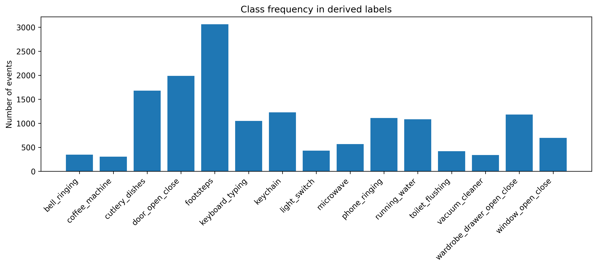
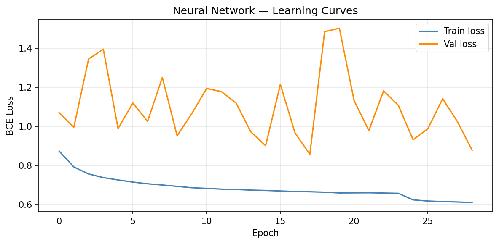

# Sound Event Detection — MLPC 2026

**Machine Learning · Audio Classification · Deep Learning · Multi-label Sound Event Detection**

A university research and engineering project on detecting overlapping everyday sound events in audio. Developed as part of **Team Unsupervised Predictors** by **Volodymyr Halian** and **Oleksandr Kudriavchenko**, with dataset exploration, annotation analysis, classical baselines, multi-label MLPs, temporal refinement, a CRNN experiment, and fine-tuning a pre-trained audio model.

> **Repository provenance:** This repository contains original student project artifacts plus **newly reconstructed code** where local files were deleted. Reported metrics are taken from the original student reports and **have not been independently reproduced from the partial uploaded data**. Read [RECOVERY_NOTES.md](RECOVERY_NOTES.md) before using the new scripts.

## Highlights

| Model / experiment | Segment-based Macro F1 | Status |
|:--|--:|:--|
| Decision Tree baseline | 0.3170 | Reported, original notebook retained |
| Tuned 3-layer feed-forward neural network | 0.4175 | Reported, original notebook and weights retained |
| CRNN (3 convolution layers + GRU) | 0.6000 | Reported; reference architecture reconstructed |
| Fine-tuned BEATs Strong | **0.6420** | Reported; original training script and weights unavailable |

The values above refer to the project evaluation reported in [The Challenge](docs/reports/03_challenge.pdf); they are **not outputs of a run of these newly reconstructed scripts**.

## Problem

The challenge is to identify 15 overlapping household sounds (such as `running_water`, `phone_ringing`, `footsteps`, `microwave`, and `door_open_close`) with onset and offset timestamps. Recordings include background noise, class imbalance, overlapping events and ambiguous event boundaries.

**Key takeaways from the report:**
- A majority-vote labeling strategy was used to aggregate multiple annotators. The exploratory analysis reported **Cohen’s κ = 0.8258** and **98.36% naive agreement**; these values differ partly because background dominates.
- MLP macro F1 exceeded the Decision Tree baseline, while the study also identified false positives and short-event detection weaknesses.
- Temporal smoothing improved the *Decision Tree baseline* Macro F1 from **0.3170 to 0.3516** with `α = 2.0` in the reported experiment.
- The fine-tuned BEATs Strong checkpoint delivered the highest **reported** score, but short transient sounds remained difficult.

## Workflow

```text
Audio files + human annotations
             │
             ▼
 Feature extraction (~32 ms frames)
             │
             ▼
  1-second windows, 0.5-second hops
             │
             ▼
 Majority vote + recording-level split
             │
             ▼
 Decision Tree → MLP → CRNN → BEATs
             │
             ▼
Multi-label predictions + smoothing + segment-based Macro F1
```

The recreated feature pipeline is a documented approximation of the missing university extractor; different input distributions can change model behavior.

## Results visualization



*Original project plot: class frequency is uneven; this motivated class-aware evaluation.*



*Original project figure retained from the submitted code archive.*

## Repository layout

```text
src/sed_portfolio/       Reconstructed reusable code (features, prepare, models, MLP/CRNN training, inference)
tests/                   Unit tests using synthetic arrays
notebooks/               Original notebooks, stripped of executed outputs
legacy/                  Original surviving Python scripts
checkpoints/             Two original small MLP state_dict files
docs/reports/            Three uploaded PDF reports
docs/figures/            Selected original result figures
data/                    Local dataset location (files ignored by Git)
RECOVERY_NOTES.md        Complete origin and limitation disclosure
```

## Quick start

Requirements: **Python 3.10+** and enough memory for PyTorch and librosa. First, create a virtual environment and install dependencies:

```bash
python -m venv .venv
# Windows PowerShell: .venv\Scripts\Activate.ps1
# macOS/Linux: source .venv/bin/activate
python -m pip install -e '.[test]'
pytest -q
```

### Option A — Train using the surviving prepared dataset (recommended)

Extract the user-owned `mlpc.zip` locally. Copy `mlpc/prepared_outputs/prepared_dataset.npz` to `data/prepared_dataset.npz`, then run:

```bash
python -m sed_portfolio.train_mlp --dataset data/prepared_dataset.npz --preset development --epochs 10 --output-dir outputs/development
```

This dataset contains MFCC features (`32` columns) and binary labels. The `development` MLP preset mirrors the surviving original model architecture. The script is a **fresh training run**, not a claimed recreation of the reported metric.

### Option B — Recompute approximate features from available audio

If you have permission to use the raw `.wav` recordings and corresponding annotation CSV:

```bash
python -m sed_portfolio.features --audio-dir data/raw_audio --annotations data/annotations.csv --output-dir data/audio_features
python -m sed_portfolio.prepare --features-dir data/audio_features --output data/reconstructed_dataset.npz
python -m sed_portfolio.train_mlp --dataset data/reconstructed_dataset.npz --preset development --epochs 10 --output-dir outputs/reconstructed
```

The extractor writes aligned `mfcc_mean` and the 960-dimensional concatenated challenge feature vector. It also builds per-segment annotator arrays if annotations are provided. It requires local source audio — **`.npz` files cannot be recreated from PDFs or screenshots alone**.

### Option C — Train the reconstructed CRNN on mel features

```bash
python -m sed_portfolio.train_crnn --features-dir data/audio_features --epochs 10 --output-dir outputs/crnn
```

This is a **new reference experiment**, operating on reconstructed mel features. The report describes an original CRNN working with raw audio; this script does **not** reproduce its exact training process or the reported `0.6000` F1.

### Option D — Run inference with an original model checkpoint

If you have the matching original per-recording features:

```bash
python -m sed_portfolio.predict_mlp --features-dir data/audio_features \
  --checkpoint checkpoints/original_challenge_mlp.pt \
  --preset challenge --output outputs/predictions.csv
```

On Windows, run the command on one line (without the trailing `\`). Predictions are written in `filename,annotation,onset,offset` format. The challenge checkpoint expects a **960-dimensional feature input** in the original feature order; using reconstructed features may invalidate predictions.

## Academic artifacts and credit

| Document | Scope |
|---|---|
| [Evaluation](docs/reports/01_evaluation.pdf) | Metric selection and random baseline |
| [Data Exploration](docs/reports/02_data_exploration.pdf) | Annotations, class distribution, audio feature analysis |
| [The Challenge](docs/reports/03_challenge.pdf) | Decision Tree, FNN, post-processing, CRNN and BEATs comparisons |

Project reports are coauthored by **Oleksandr Kudriavchenko** and **Volodymyr Halian**. The retained university-provided starter notebooks and evaluator are marked as originals, and reconstructed files are clearly documented. The original reports also disclose assistance from LLM tools for examples, understanding and editing.

## Important limitations

This repository is useful for code review, study, and rebuilding the experiment, but **does not ship** private raw audio, original full `.npz` dataset or the missing BEATs Strong checkpoint. Differences between the original extractor and the reconstruction mean **historical scores cannot be validated without the original environment and data**.

See [RECOVERY_NOTES.md](RECOVERY_NOTES.md) for a precise inventory of what is original versus newly implemented.
